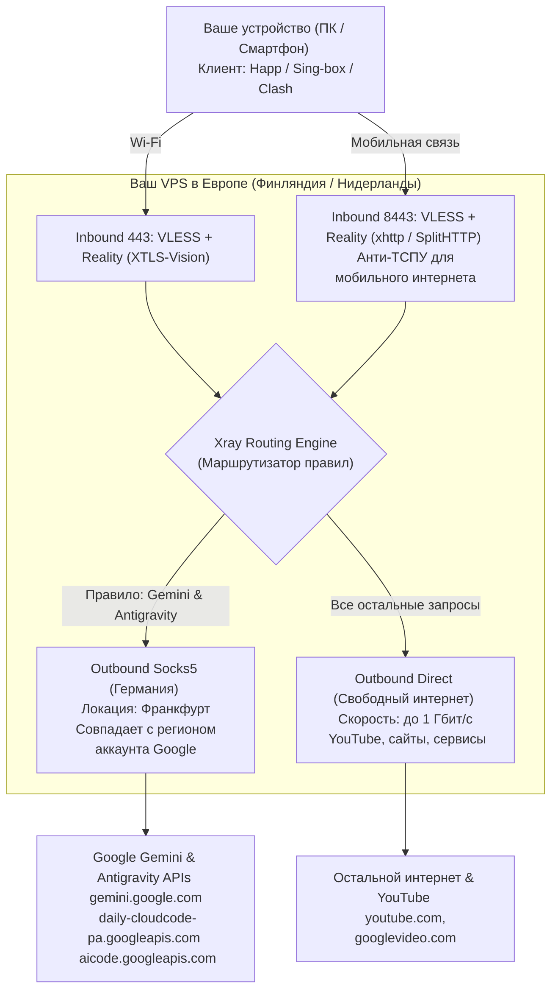
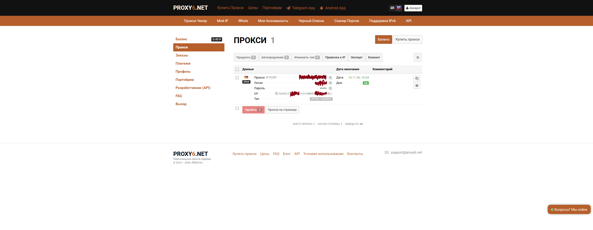
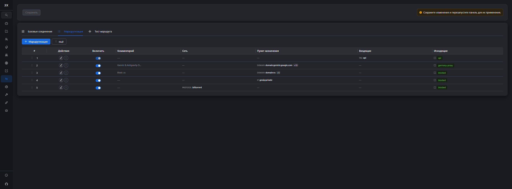
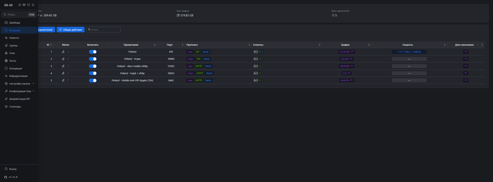

# Полный гайд: Обход ограничений Google Gemini и Antigravity через VPS и X-UI

> **Актуальность:** 07.11.2026  
> **Проблема:** Google блокирует датацентровые IP-адреса зарубежных хостингов (Hetzner, OVH, DigitalOcean и др.) при обращении к Gemini и Antigravity (выдавая ошибку `403 Forbidden`, `Location not supported` или `context deadline exceeded`). В то же время мобильные операторы в РФ через ТСПУ блокируют стандартные VPN-протоколы и нестандартные порты.  
> **Особенность кейса:** Регион аккаунта Google — **Германия**, поэтому Google строго требует немецкий IP-адрес для работы ИИ-сервисов.  
> **Решение:** Связка собственного VPS в Европе (для высокоскоростного трафика и YouTube) с точечным роутингом трафика Gemini/Antigravity через недорогой серверный IPv4-прокси Германии в панели **3X-UI**, а также добавление анти-DPI инбаунда для мобильных сетей.

---

## Архитектура решения



---

## Содержание
1. [Шаг 1. Аренда и первичная настройка VPS](#шаг-1-аренда-и-первичная-настройка-vps)
2. [Шаг 2. Установка панели 3X-UI](#шаг-2-установка-панели-3x-ui)
3. [Шаг 3. Покупка прокси Германии (Регион аккаунта)](#шаг-3-покупка-прокси-германии-регион-аккаунта)
4. [Шаг 4. Настройка Outbound и правильного роутинга в X-UI](#шаг-4-настройка-outbound-и-правильного-роутинга-в-x-ui)
5. [Шаг 5. Настройка узлов для мобильного интернета (Обход ТСПУ)](#шаг-5-настройка-узлов-для-мобильного-интернета-обход-тспу)
6. [Шаг 6. Настройка клиента Happ и автовыбора по пингу](#шаг-6-настройка-клиента-happ-и-автовыбора-по-пингу)
7. [Чек-лист проверки и устранения неполадок](#чек-лист-проверки)

---

## Шаг 1. Аренда и первичная настройка VPS

Для стабильного доступа к глобальному интернету нужен виртуальный сервер (VPS) за пределами РФ:
* **Локация:** Финляндия, Нидерланды, Германия, Швеция.
* **Минимальные характеристики:** 1 vCPU, 1 ГБ RAM, 10–20 ГБ NVMe, ОС **Debian 12 / 13**.
* **Провайдеры:** AdminVPS, Aeza, Timeweb Cloud, Friendhosting и др.

После создания сервера подключитесь к нему по SSH:
```bash
ssh root@<IP_ВАШЕГО_СЕРВЕРА>
```

Обновите пакеты:
```bash
apt-get update && apt-get upgrade -y
apt-get install -y curl wget sqlite3 tar
```

---

## Шаг 2. Установка панели 3X-UI

**3X-UI** — лучшая веб-панель для управления Xray. Она поддерживает VLESS-Reality, SplitHTTP (xhttp), балансировку подписок и гибкий роутинг.

Установите панель официальным скриптом:
```bash
bash <(curl -Ls https://raw.githubusercontent.com/mhsanaei/3x-ui/master/install.sh)
```
В процессе установки задайте:
* Логин администратора
* Пароль администратора
* Порт веб-панели (например, `33301`)
* Путь доступа (Web Base Path)

После завершения перейдите в браузере по адресу:
`https://<IP_СЕРВЕРА>:<ПОРТ>/<BASE_PATH>/`

---

## Шаг 3. Покупка прокси Германии (Регион аккаунта)

### Зачем нужен именно немецкий прокси?
Если регион вашего аккаунта Google (платежный профиль, Google Play, семейная группа или регистрация) привязан к **Германии**, алгоритмы безопасности Google сверяют геолокацию запросов к Gemini и Antigravity с домашней страной аккаунта:
1. **Несоответствие регионов:** Если заходить с IP Финляндии или Нидерландов, Google часто выдает ошибку *«Gemini is not available in your country/region»* или требует подтверждение личности.
2. **Блокировка датацентров:** Google блокирует диапазоны IP хостинг-провайдеров. Обычный персональный IPv4-прокси из Германии решает обе проблемы: дает чистый IP и полностью соответствует стране аккаунта.

### Как купить прокси:
1. Зайдите на **[Proxy6.net](https://proxy6.net/)** (или любой проверенный сервис прокси).
2. Выберите параметры:
   * **Тип:** Индивидуальный IPv4 (не Shared и не IPv6).
   * **Страна:** Германия (Germany / Deutschland).
   * **Протокол:** SOCKS5 / HTTPS.
   * **Период:** 1 месяц (~110–130 руб.).
3. В личном кабинете вы получите реквизиты:
   `IP:PORT` и связку `Логин` / `Пароль`.



---

## Шаг 4. Настройка Outbound и правильного роутинга в X-UI

### 1. Добавление Outbound (Исходящего узла)
В панели перейдите в **Конфигурация Xray** -> **Исходящие (Outbounds)** (или отредактируйте шаблон конфигурации):

Добавьте узел с тегом `germany-proxy`:
```json
{
  "tag": "germany-proxy",
  "protocol": "socks",
  "settings": {
    "servers": [
      {
        "address": "<IP_ВАШЕГО_ПРОКСИ>",
        "port": <ПОРТ_ПРОКСИ>,
        "users": [
          {
            "user": "<ЛОГИН_ПРОКСИ>",
            "pass": "<ПАРОЛЬ_ПРОКСИ>"
          }
        ]
      }
    ]
  }
}
```

### 2. Добавление правила маршрутизации (Routing Rule)
> [!WARNING]
> **Критическая ошибка:** Никогда не заворачивайте в немецкий прокси всё правило `geosite:google` или `domain:google.com`!  
> В сервисы Google входят YouTube (`googlevideo.com`, `youtubei.googleapis.com`) и DNS `8.8.8.8`. Если пустить весь трафик Google через прокси, скорость YouTube упадёт до нуля, а видео начнёт зависать.

В **Маршрутизация (Routing)** добавляется точечное правило, направляющее в `germany-proxy` **только** Gemini и Antigravity:

```json
{
  "type": "field",
  "enabled": true,
  "comment": "Gemini & Antigravity ONLY via Germany",
  "domain": [
    "domain:gemini.google.com",
    "domain:bard.google.com",
    "domain:aistudio.google.com",
    "domain:makersuite.google.com",
    "domain:ai.google.dev",
    "domain:deepmind.google",
    "domain:deepmind.com",
    "domain:generativelanguage.googleapis.com",
    "domain:daily-cloudcode-pa.googleapis.com",
    "domain:cloudcode-pa.googleapis.com",
    "domain:aicode.googleapis.com",
    "domain:cloudaicompanion.googleapis.com",
    "domain:alkalimakersuite-pa.clients6.google.com",
    "domain:alkali.clients6.google.com",
    "domain:geller-pa.googleapis.com",
    "domain:proactivebackend-pa.googleapis.com"
  ],
  "outboundTag": "germany-proxy"
}
```

* **Почему нужны `daily-cloudcode-pa.googleapis.com` и `aicode.googleapis.com`?**  
  Это внутренние gRPC/SSE-эндпоинты Google Cloud Code, через которые Antigravity IDE загружает проекты и генерирует код с помощью Gemini. Без них Antigravity выдаёт таймаут соединения.



---

## Шаг 5. Настройка узлов для мобильного интернета (Обход ТСПУ)

На мобильных сетях в РФ ТСПУ блокирует:
1. Порты выше 1024 с TLS-рукопожатиями.
2. Протокол VLESS-Reality без маскировки размера пакетов (**XTLS-Vision**).

### Узел 1: Основной VLESS-Reality (Wi-Fi и десктоп)
* **Порт:** `443`
* **Протокол:** `VLESS` + `TCP` + `Reality`
* **Маскировка (SNI / Dest):** `swdist.apple.com:443` или `gateway.icloud.com:443`
* **Flow (Обязательно):** `xtls-rprx-vision` (без этого параметра ТСПУ обрывает сессию на мобильных сетях).

### Узел 2: Anti-DPI VLESS-xhttp (Специально для мобильных операторов)
* **Порт:** `8443` (стандартный альтернативный HTTPS, разрешён на МТС, Мегафон, Билайн, Т2)
* **Сеть:** `xhttp` (SplitHTTP)
  * Режим: `packet-up`
  * Дополнительный паддинг: `xPaddingBytes: 100-1000`
* **Маскировка (Reality):** `swdist.apple.com:443` (CDN обновлений Apple)
  * Пакеты разбиваются на легитимные чанки HTTP/2, трафик неотличим от обычной загрузки файлов с серверов Apple.



---

## Шаг 6. Настройка клиента Happ и автовыбора по пингу

Для подключения на iOS, Android, Windows и macOS рекомендуется клиент **Happ** (на ядре Sing-box).

### 1. Добавление подписки
Скопируйте ссылку вашей подписки из панели 3X-UI:
```text
https://<IP_СЕРВЕРА>:2096/<SUB_PATH>/<ВАШ_SUB_ID>
```
Вставьте её в Happ -> нажмите **«Обновить»**. Появятся все созданные узлы.

### 2. Настройка автоматического выбора по пингу (Auto / URL-Test)
Чтобы на Wi-Fi всегда выбирался самый быстрый узел с минимальной задержкой:
1. В Happ откройте вкладку **Группы (Groups)** или меню подписки.
2. Создайте группу с типом **Auto / URL-Test**.
3. Укажите интервал проверки (например, 300 сек) и тестовый URL:  
   `http://www.gstatic.com/generate_204`
4. Включите в группу все ваши узлы.  
   Happ будет в фоновом режиме тестировать задержку и автоматически переключать соединение на узел с наименьшим пингом.

---

## Чек-лист проверки

1. **Проверка IP в браузере:**  
   Откройте [2ip.ru](https://2ip.ru) — должен отображаться IP вашего VPS (Финляндия / Нидерланды).
2. **Проверка YouTube:**  
   YouTube должен мгновенно открывать видео в 4K с европейского сервера без задержек.
3. **Проверка Gemini:**  
   Перейдите на [gemini.google.com](https://gemini.google.com) — сайт открывается без плашки «Страна не поддерживается».
4. **Проверка Antigravity:**  
   В Antigravity отправьте любой запрос — модель отвечает без задержек и ошибок сети.

---

*Автор руководства: Wasyliy*  
*Лицензия: MIT*
